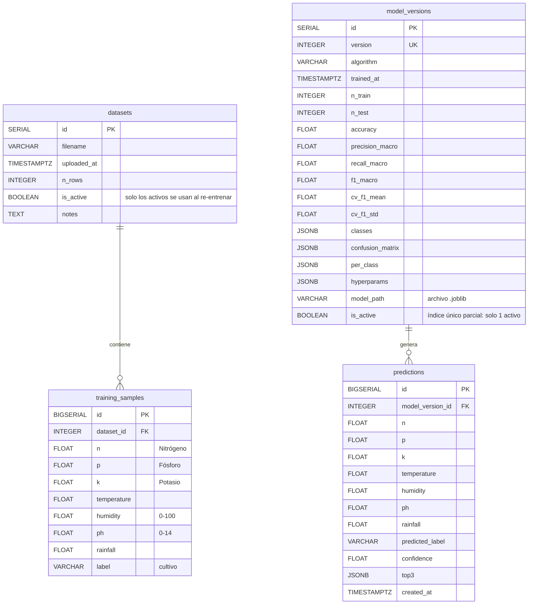

# Diagrama de base de datos

Motor: **PostgreSQL 16**. Script de generación: [`backend/db/schema.sql`](../backend/db/schema.sql).



## Decisiones de diseño

| Decisión | Motivo |
|---|---|
| `datasets` separada de `training_samples` | Cada CSV subido queda registrado (trazabilidad). Se puede activar o desactivar un lote entero sin borrar datos. |
| Restricciones `CHECK` en pH, humedad y nutrientes | Son la primera barrera de calidad de datos (QA de CRISP-ML(Q)), además de la validación de la API. |
| `model_versions` guarda las métricas y la ruta del `.joblib` | Versionado de modelos: se puede comparar, auditar y volver a una versión anterior. |
| Índice único parcial `WHERE is_active` | La BD garantiza que nunca haya dos modelos activos a la vez. |
| `predictions.model_version_id` | Cada predicción del historial queda ligada al modelo que la hizo (monitoreo). |
| `JSONB` para la matriz de confusión y las métricas por clase | Estructuras de tamaño variable según el número de clases; se devuelven tal cual a la API. |

## Cómo generar la base de datos

**Opción A: Docker (recomendada).** El script se ejecuta solo al crear el contenedor:
```bash
docker compose up -d
```

**Opción B: PostgreSQL instalado localmente**
```bash
createdb -U postgres crop_ai
psql -U postgres -d crop_ai -f backend/db/schema.sql
```

Al arrancar, la API carga automáticamente `data/Crop_recommendation.csv` en `datasets` y `training_samples` y entrena el modelo v1 si la BD está vacía.
