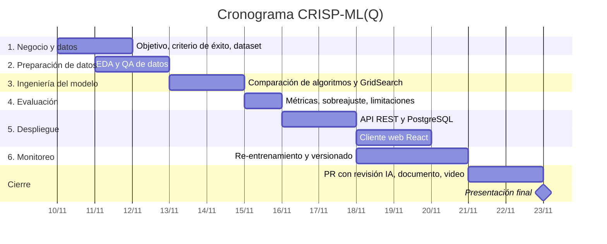

# Recomendador de Cultivos con IA
## Aplicación de CRISP-ML(Q) y desarrollo del servicio y el cliente web

**Materia:** Taller de Sistemas Inteligentes. Evaluación de la Unidad 4 y final
**Dataset:** [Crop Recommendation Dataset (Kaggle)](https://www.kaggle.com/datasets/atharvaingle/crop-recommendation-dataset)
**Tipo de problema:** aprendizaje supervisado, **clasificación multiclase** (22 cultivos)

---

## 1. Resumen

Se construyó un sistema que recomienda el cultivo más adecuado para una parcela a partir de 7 variables del suelo y del clima. El modelo, un pipeline de `StandardScaler` y `RandomForestClassifier`, consigue un **F1 macro de 0.9955 y una accuracy de 0.9955** en el conjunto de prueba, con un F1 de validación cruzada de 0.995 ± 0.005. El modelo se expone mediante un **servicio REST (FastAPI)** con persistencia en **PostgreSQL**, y lo consume una **aplicación web en React** que usa todos los endpoints: predicción, historial, métricas, carga de CSV y re-entrenamiento.

```
 Jupyter (EDA y experimentos) ─► Servicio de IA (Python · FastAPI · scikit-learn) ◄── REST/JSON ──► Cliente web (React)
                                          │
                                          ▼
                       PostgreSQL: datasets · training_samples · model_versions · predictions
```

---

## 2. Metodología CRISP-ML(Q)

CRISP-ML(Q) (*Cross-Industry Standard Process for Machine Learning with Quality assurance*) amplía CRISP-DM con dos ideas: **cada fase tiene un paso explícito de garantía de calidad** (identificar riesgos y aplicar medidas para mitigarlos) y el ciclo **no termina en el despliegue**, sino en el monitoreo y mantenimiento del modelo. Sus seis fases y cómo se aplicaron en este proyecto se describen a continuación.

### 2.1 Cronograma de trabajo

> Periodo de trabajo: **10 al 22 de noviembre de 2026**. Presentación final: **23 de noviembre de 2026**.

| # | Fase CRISP-ML(Q) | Actividades | Entregable | Fechas |
|---|---|---|---|---|
| 1 | Comprensión del negocio y de los datos | Definir el objetivo, el criterio de éxito, el alcance y la viabilidad. Buscar y elegir el dataset | Sección 3 de este documento | 10–11 nov |
| 2 | Preparación de los datos | EDA, QA de datos (nulos, duplicados, outliers, balance), split estratificado y escalado | Notebook, secciones 1–3 | 11–12 nov |
| 3 | Ingeniería del modelo | Comparar 7 algoritmos con CV de 5 folds y ajustar hiperparámetros con GridSearchCV | Notebook, sección 4 | 13–14 nov |
| 4 | Evaluación del modelo | Métricas en test, matriz de confusión, sobreajuste, importancia de variables, limitaciones | Notebook, sección 5 | 15 nov |
| 5 | Despliegue | API REST, esquema de la BD, Swagger, cliente React, tests | `backend/`, `frontend/`, `docs/` | 16–19 nov |
| 6 | Monitoreo y mantenimiento | Historial, avisos fuera de rango, carga de CSV, re-entrenamiento con control de calidad, versionado y rollback | Endpoints `/predictions`, `/retrain`, `/datasets/upload` | 18–20 nov |
| – | Cierre | Revisión de PR con IA (Qodo Merge), video demostrativo y documento final | Repositorio en GitHub, video | 21–22 nov |
| ★ | Presentación final | Exposición y demostración del sistema | Video y documentos | 23 nov |



---

## 3. Fase 1: Comprensión del negocio y de los datos

**Problema de negocio.** Elegir mal el cultivo para las condiciones del suelo y del clima reduce el rendimiento y desperdicia fertilizante y agua. Un agricultor o técnico agrícola necesita una recomendación rápida a partir de mediciones que ya tiene: el análisis de suelo (N, P, K, pH) y los datos climáticos de la zona.

**Objetivo de ML.** Dado un vector de 7 variables, predecir cuál de los 22 cultivos es el más adecuado y con qué confianza.

**Criterios de éxito (medibles).**

| Criterio | Umbral | Resultado |
|---|---|---|
| F1 macro en el conjunto de prueba | ≥ 0.95 | **0.9955** ✅ |
| Estabilidad: desviación estándar del F1 en CV de 5 folds | < 0.02 | **0.005** ✅ |
| F1 de la peor clase | ≥ 0.90 | **0.974** ✅ |
| Tiempo de respuesta de `/predict` | < 500 ms | ≈ 20 ms ✅ |

**Datos.** 2200 registros y 8 columnas:

| Variable | Descripción | Rango |
|---|---|---|
| N, P, K | Nitrógeno, fósforo y potasio en el suelo (kg/ha) | 0–140, 5–145, 5–205 |
| temperature | Temperatura media (°C) | 8.8–43.7 |
| humidity | Humedad relativa (%) | 14.3–99.98 |
| ph | pH del suelo | 3.5–9.9 |
| rainfall | Precipitación (mm) | 20.2–298.6 |
| **label** | Cultivo (22 clases: rice, maize, coffee, apple…) | 100 muestras por clase |

**QA de la Fase 1: riesgos identificados**
- *Riesgo:* los datos proceden de condiciones de la India y quizá no se generalicen a otras regiones. → *Mitigación:* el sistema permite subir datos locales y re-entrenar (Fase 6), y avisa cuando una entrada sale del rango de entrenamiento.
- *Riesgo:* el dataset es pequeño (2200 filas). → *Mitigación:* validación cruzada estratificada en lugar de un único split.

---

## 4. Fase 2: Preparación de los datos (Data Engineering)

Todo el análisis está en [`notebooks/01_eda_y_entrenamiento.ipynb`](../notebooks/01_eda_y_entrenamiento.ipynb).

**Hallazgos del EDA**
- **0 valores nulos y 0 filas duplicadas.**
- **Clases perfectamente balanceadas** (100 por clase), así que no hace falta sobremuestreo y la accuracy es una métrica representativa. Aun así se reportan métricas *macro*.
- **Correlación alta entre P y K (ρ ≈ 0.74)**, causada sobre todo por las uvas y las manzanas, que necesitan mucho de ambos.
- Los **outliers** según el criterio IQR en P, K y rainfall corresponden a cultivos concretos (apple y grapes en K, rice en rainfall). **Son información del dominio, no errores**, así que se conservan.
- El **mapa de perfiles por cultivo** (valor medio de cada variable por cultivo) muestra que cada cultivo tiene una combinación de condiciones propia: el arroz destaca por la lluvia (236 mm), la manzana y la uva por el fósforo y el potasio, y el garbanzo y el frijol rojo por una humedad muy baja. Esto anticipa una precisión alta.

**Preparación aplicada**
1. Separación **80/20 estratificada** (`random_state=42`): 1760 filas de entrenamiento y 440 de prueba.
2. `StandardScaler` **dentro del Pipeline**, para que el escalado se ajuste solo con los datos de entrenamiento (sin *data leakage*) y viaje junto al modelo al desplegarlo.

**QA de la Fase 2.** Las mismas reglas de calidad se implementaron en producción (`backend/app/ml.py → parse_and_validate_csv`): columnas obligatorias, conversión a número, **rangos físicos válidos** (pH 0–14, humedad 0–100 %, etc.), eliminación de duplicados y normalización de las etiquetas (minúsculas, sin espacios). Las filas inválidas se rechazan y se informan al usuario. A esto se suman las restricciones `CHECK` de PostgreSQL.

---

## 5. Fase 3: Ingeniería del modelo

Se compararon 7 algoritmos con el mismo pipeline (escalado y clasificador) y **validación cruzada estratificada de 5 folds** sobre el conjunto de entrenamiento:

| Modelo | F1 macro (CV) | Desv. est. |
|---|---|---|
| GaussianNB | 0.9949 | 0.0042 |
| **Random Forest** | **0.9926** | 0.0059 |
| Gradient Boosting | 0.9869 | 0.0036 |
| Decision Tree | 0.9852 | 0.0068 |
| SVC | 0.9788 | 0.0106 |
| Logistic Regression | 0.9678 | 0.0068 |
| KNN | 0.9650 | 0.0124 |

**Por qué Random Forest.** GaussianNB y Random Forest están empatados dentro de la desviación estándar. Se eligió Random Forest porque (1) no asume independencia entre variables, algo que la correlación entre P y K viola; (2) es robusto frente a outliers; (3) ofrece **importancia de variables**, que da explicabilidad; y (4) sus probabilidades sirven como **confianza** de la recomendación.

**Ajuste de hiperparámetros** con `GridSearchCV` (18 combinaciones, CV de 5 folds):
`n_estimators ∈ {100, 200, 300}`, `max_depth ∈ {None, 10, 20}`, `min_samples_split ∈ {2, 5}`.
**Mejor combinación:** `n_estimators=200, max_depth=None, min_samples_split=5`, con un F1 en CV de **0.9954**.

---

## 6. Fase 4: Evaluación del modelo

**Resultados en el conjunto de prueba (440 muestras nunca vistas):**

| Métrica | Valor |
|---|---|
| Accuracy | **0.9955** |
| Precision (macro) | 0.9957 |
| Recall (macro) | 0.9955 |
| F1 (macro) | **0.9955** |

Solo **2 errores de 440**: un *blackgram* clasificado como *maize* y un *rice* clasificado como *jute*. Son cultivos con condiciones de humedad y lluvia que se solapan (rice y jute crecen en climas húmedos con mucha lluvia). Las 20 clases restantes tienen un F1 de 1.0.

**Importancia de variables:** rainfall (22 %), humidity (22 %), K (18 %), P (15 %), N (11 %), temperature (8 %), pH (5 %). Tiene sentido agronómico: el régimen hídrico es lo que más separa los cultivos.

**QA de la Fase 4: ¿sobreajuste?** La accuracy en entrenamiento es 1.0 y en prueba 0.9955. La diferencia es mínima, la CV es estable (σ = 0.005) y el rendimiento en test coincide con el de CV, así que el modelo **generaliza bien dentro de la distribución del dataset**. La precisión tan alta se explica por la buena separación de las clases observada en el EDA.

**Limitaciones documentadas.**
1. Datos de una sola región geográfica.
2. Faltan variables relevantes como el tipo de suelo, la altitud o la estación del año.
3. El modelo recomienda *un* cultivo, pero en la práctica pueden ser viables varios. Por eso la API devuelve el **top 3 con sus probabilidades**.

---

## 7. Fase 5: Despliegue

### 7.1 Arquitectura y tecnologías

| Componente | Tecnología | Motivo |
|---|---|---|
| Experimentación | Jupyter, pandas, seaborn | EDA reproducible |
| Modelo | scikit-learn (Pipeline), joblib | El mismo artefacto en el notebook y en producción |
| Servicio de IA | **Python 3 + FastAPI** + SQLAlchemy 2 | Validación con Pydantic y **Swagger/OpenAPI generado automáticamente** |
| Base de datos | **PostgreSQL 16** (Docker) | Integridad referencial, JSONB e índices parciales |
| Cliente web | **React 19 + Vite** | SPA que consume todos los endpoints |
| Calidad | pytest (8 tests de integración), oxlint, revisión de PR con IA | |

**Estructura del backend**
```
backend/app/
├── main.py          # App FastAPI, CORS, arranque (carga el CSV semilla y entrena v1)
├── config.py        # Configuración por variables de entorno (.env)
├── database.py      # Engine y sesión de SQLAlchemy
├── models.py        # ORM (refleja db/schema.sql)
├── schemas.py       # Contratos Pydantic de entrada y salida (generan el Swagger)
├── ml.py            # Entrenamiento, evaluación, validación de CSV y ModelStore en memoria
├── services.py      # Casos de uso: ingestar dataset, re-entrenar, versionar, activar
└── routers/         # predictions.py · models.py · datasets.py
```

### 7.2 API REST

La documentación interactiva está en **`http://localhost:8001/docs`** (Swagger UI) y la especificación en [`docs/openapi.json`](openapi.json) y [`docs/swagger.yaml`](swagger.yaml).

| Requisito del enunciado | Método y ruta | Descripción |
|---|---|---|
| a) Enviar datos y obtener la predicción | `POST /api/predict` | Recibe las 7 variables validadas. Devuelve el cultivo, la confianza, el top 3, avisos y la versión del modelo. Se guarda en el historial |
| b) Historial de predicciones | `GET /api/predictions?page=&size=&label=` | Datos enviados y resultado, paginado y filtrable |
| | `GET /api/predictions/{id}` | Detalle de una predicción |
| c) Métricas de rendimiento | `GET /api/metrics?version=` | Accuracy, precision, recall, F1, F1 de CV, matriz de confusión, métricas por clase e importancia de variables |
| d) Re-entrenamiento | `POST /api/retrain?force=` | Entrena con todos los datasets activos y crea una nueva versión |
| e) Enviar el archivo de entrenamiento | `POST /api/datasets/upload` (multipart) | CSV con `mode=append|replace` y `retrain=true|false` opcional |
| Extras | `GET /api/models`, `POST /api/models/{v}/activate` | Versiones y rollback |
| | `GET /api/datasets`, `PATCH /api/datasets/{id}`, `GET /api/datasets/template` | Gestión de los datos y plantilla CSV |
| | `GET /api/health` | Estado de la BD y del modelo |

**Ejemplo**
```http
POST /api/predict
{"N": 90, "P": 42, "K": 43, "temperature": 20.88, "humidity": 82, "ph": 6.5, "rainfall": 202.9}

200 OK
{"id": 1, "label": "rice", "confidence": 0.9078,
 "top3": [{"label": "rice", "probability": 0.9078}, {"label": "jute", "probability": 0.0852}, {"label": "papaya", "probability": 0.0069}],
 "warnings": [], "model_version": 1, "created_at": "2026-11-23T22:07:57Z"}
```

**Errores:** `422` si los datos no son válidos (rango, tipo, CSV mal formado), `409` si ya hay un re-entrenamiento en curso, `404` si el recurso no existe, `413` si el archivo es demasiado grande y `503` si no hay modelo activo.

### 7.3 Base de datos

Diagrama y decisiones de diseño en [`docs/diagrama_bd.md`](diagrama_bd.md). Script de generación en [`backend/db/schema.sql`](../backend/db/schema.sql). Tiene cuatro tablas: `datasets`, `training_samples`, `model_versions` y `predictions`.

### 7.4 Cliente web (React)

| Pestaña | Endpoints que usa | Funcionalidad |
|---|---|---|
| 🌱 Predecir | `POST /predict` | Formulario con validación, ejemplos precargados, resultado con confianza, top 3 y avisos fuera de rango |
| 🕘 Historial | `GET /predictions` | Tabla paginada con filtro por cultivo |
| 📊 Métricas | `GET /metrics`, `GET /models`, `POST /models/{v}/activate` | Indicadores de métricas, F1 por cultivo, importancia de variables, matriz de confusión interactiva (con vista de tabla), selector de versión y rollback |
| 🗂 Datos y re-entrenamiento | `POST /datasets/upload`, `POST /retrain`, `GET/PATCH /datasets`, `GET /datasets/template` | Carga de CSV con un informe de validación, re-entrenamiento normal o forzado, lista de datasets activables y distribución de clases |
| Cabecera | `GET /health` | Estado del servicio y versión del modelo activo |

Tiene modo claro y oscuro automático y nombres de cultivos en español.

### 7.5 QA del despliegue
- **Mismo artefacto** en el notebook y en el servicio (Pipeline con el escalado incluido), lo que evita el desajuste entre entrenamiento y producción (*training-serving skew*).
- **Validación de entrada** con Pydantic (rangos físicos) en cada petición.
- **Tests de integración** (`backend/tests/test_api.py`, 8 tests) contra una BD PostgreSQL de pruebas. Uno de ellos comprueba el criterio de éxito (F1 ≥ 0.95).
- **Revisión de código con IA** en los Pull Requests de GitHub (ver la sección 9).

---

## 8. Fase 6: Monitoreo y mantenimiento

| Mecanismo | Implementación |
|---|---|
| **Trazabilidad** | Cada predicción se guarda con sus datos de entrada, resultado, confianza, top 3 y la versión del modelo que la hizo |
| **Detección de entradas fuera de distribución** | `/predict` devuelve `warnings` si alguna variable sale del rango visto en entrenamiento (detección simple de *data drift*) |
| **Actualización de datos** | `POST /datasets/upload`, en modo `append` (sumar datos nuevos) o `replace` (sustituir) |
| **Re-entrenamiento con puerta de calidad** | El nuevo modelo **solo se activa si su F1 macro no empeora más de 0.01** respecto al activo. Si no, se guarda pero sigue en producción el modelo anterior. `force=true` permite saltarse la puerta de forma explícita |
| **Versionado y rollback** | Cada entrenamiento crea una fila en `model_versions` y un archivo `model_vN.joblib`. Se puede reactivar cualquier versión anterior |
| **Concurrencia** | Un *lock* impide dos re-entrenamientos simultáneos (devuelve `409`). Un índice único parcial en la BD garantiza un solo modelo activo |

---

## 9. Herramientas de apoyo: IA generativa y revisión de código

- **IA generativa:** se usó un asistente de IA (Claude Code) para el andamiaje del proyecto, la generación de código del backend y del frontend, los tests y la documentación, siempre con revisión y validación manual de los resultados (ejecución del notebook, tests automáticos y pruebas de extremo a extremo).
- **GitHub y revisión de PR con IA:** el desarrollo se organizó con tres ramas (`main`, `develop` y `feature/...`) integradas mediante Pull Requests revisados por **Qodo Merge** (`/describe`, `/review`, `/improve`). Las capturas de la revisión están en `docs/evidencias/`.

---

## 10. Conclusiones

1. El dataset permitió entrenar un clasificador que **supera con holgura el criterio de éxito** (F1 de 0.9955 frente al 0.95 exigido) y que es estable en la validación cruzada.
2. CRISP-ML(Q) sirvió para que la calidad no quedara solo en la métrica final: cada fase identificó riesgos (datos regionales, outliers, sobreajuste, desajuste entre entrenamiento y producción, degradación tras re-entrenar) y los mitigó con mecanismos concretos del sistema.
3. El sistema está listo para un ciclo de vida real: recibe datos nuevos, re-entrena con una puerta de calidad, versiona y permite volver atrás, y su API está totalmente documentada con OpenAPI.

**Trabajo futuro:** incorporar variables de tipo de suelo y estación, detectar el drift con pruebas estadísticas (PSI o KS) sobre el historial y añadir autenticación a los endpoints de administración (subir datos y re-entrenar).
